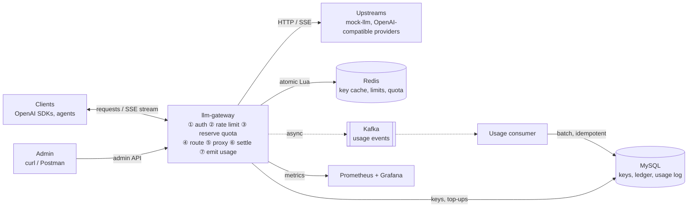

# llm-gateway

An OpenAI-compatible gateway that sits between LLM clients and model providers. It handles API keys, rate limits, prepaid quota, streaming, failover and usage accounting, and it can track and cap the cost of each agent run.

> **Status:** early development. This README describes the target design. Nothing is runnable yet; the roadmap below shows what is done.

## Why

Services that call LLMs need the same layer around every call: who is calling, how often they may call, how much they may spend, and what each call actually cost. Agents make this harder, because one task can fan out into many model calls, and a loop can burn through a budget quickly.

llm-gateway puts that layer in one place. Clients keep using their usual OpenAI SDKs and only change `base_url`.

## Goals

- **OpenAI-compatible API:** `POST /v1/chat/completions` (streaming and non-streaming) and `GET /v1/models`, with errors in OpenAI's format
- **API keys:** random `sk-` keys stored only as SHA-256 hashes, looked up through Caffeine, Redis and MySQL
- **Rate limits:** requests per minute and tokens per minute for each key, `429` with `Retry-After`
- **Prepaid quota:** before a call, reserve the most it could cost with an atomic Redis Lua script; after the call, settle against the actual usage; a background job refunds reservations left behind by a crash
- **Streaming:** proxy SSE chunk by chunk, with connect, first-token and total timeouts, and close the upstream call when the client disconnects
- **Usage ledger:** usage events go through Kafka to MySQL with idempotent consumers, and a reconciliation job checks that balance = top-ups − spend
- **Agent runs:** group calls by an `X-Run-Id` header to report each run's calls, tokens and cost, and cap a run's spend so a looping agent stops early
- **Failover:** several upstreams per model, weighted routing, retry on another upstream before the first byte is sent, circuit breaking
- **Observability:** QPS, P50/P99 latency, time to first token, upstream errors, rate-limit rejections and Kafka lag in Prometheus and Grafana, plus k6 load tests

Out of scope: an admin web UI, splitting into microservices, and running it as a public paid service.

## Architecture



## How a request flows

1. **Auth:** hash the key and find it in the cache or the database. Unknown keys are cached too.
2. **Rate limit:** check the key's RPM and TPM limits in Redis.
3. **Reserve quota:** estimate the prompt with jtokkit, add `max_tokens`, and reserve that cost in one Lua script: deduct if there is enough, reject with `insufficient_quota` if not. With `X-Run-Id`, the run's budget is checked in the same script.
4. **Route:** pick an upstream for the requested model.
5. **Proxy:** call the upstream with the JDK HttpClient and stream chunks back as they arrive. The gateway always asks the upstream for usage and drops that chunk if the client did not ask for it.
6. **Settle:** refund or charge the difference between the reservation and the real usage. If usage never arrives, estimate it from what was received, including tool call arguments.
7. **Emit usage:** publish a usage event to Kafka. A consumer writes `usage_log` and the MySQL ledger in one transaction and only then commits the offset.

Redis holds the live limits and balances. MySQL is the source of truth for the ledger.

## Tech stack

| Area | Choice |
|---|---|
| Language and framework | Java 21+, Spring Boot, Spring MVC on virtual threads |
| Upstream calls | JDK HttpClient |
| Database | MySQL 8, MyBatis, Flyway |
| Cache, limits and quota | Redis 7 with Lua scripts and AOF; Caffeine as a local cache |
| Messaging | Kafka (KRaft) |
| Token counting | jtokkit |
| Resilience | Resilience4j |
| Testing | JUnit 5, Testcontainers with real MySQL, Redis and Kafka |
| Load testing | k6 against a mock LLM service |
| Observability | Micrometer, Prometheus, Grafana |
| Local setup and CI | Docker Compose, GitHub Actions |

## Repository layout (planned)

```
gateway/     the gateway service
mock-llm/    mock upstream with configurable latency, failures, streaming and tool calls
deploy/      Docker Compose, Prometheus and Grafana config
loadtest/    k6 scripts
examples/    Python and Java clients, including a minimal agent loop
docs/        design decisions and load test reports
```

## Roadmap

- [ ] Project skeleton, Docker Compose, CI
- [ ] Non-streaming proxy to a mock upstream
- [ ] Streaming proxy on virtual threads
- [ ] API keys and admin API
- [ ] Rate limiting
- [ ] Quota reservation and settlement
- [ ] Usage ledger on Kafka and reconciliation
- [ ] Index and locking experiments on the ledger tables
- [ ] Metrics, dashboards and load tests
- [ ] Failover, client examples, agent run budgets, and routing [FlowAI](https://github.com/vokyo/FlowAi) through the gateway
